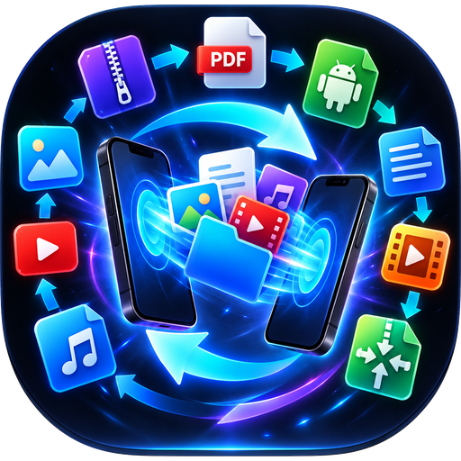

<p align="center"></p>

# Fluxo

Application Android tout-en-un créée par **SuperEssence Studio**.

## Télécharger l'APK

Va dans l'onglet **Releases** du dépôt et télécharge `Fluxo.apk` (dernière version).
L'APK est compilé automatiquement par GitHub Actions à chaque push (onglet **Actions**,
artefact `Fluxo-apk`). Android 8.0 ou plus est requis.

## Fonctions

| Outil | Détails |
|---|---|
| **Transfert** | Envoi direct d'appareil à appareil en Wi‑Fi local (TCP), sans limite de taille (2 Go et plus). Découverte automatique, QR code, ou IP manuelle. Sans Wi‑Fi : le récepteur crée un point d'accès local. La vitesse dépend du Wi‑Fi (souvent 20 à 60 Mo/s en 5 GHz). |
| **Convertir** | Vidéo → MP3, M4A, WAV, OGG, FLAC, OPUS, MP4, MKV, WEBM, AVI, MOV, GIF, images · Audio → tous formats audio · Images (JPG, PNG, WEBP, HEIC…) → JPG, PNG, WEBP, PDF · Texte/HTML → PDF · Word → TXT/PDF · PDF → TXT ou images · ZIP/7Z/RAR/TAR/GZ → extraction · tout → ZIP |
| **XAPK → APK** | XAPK, APKS, APKM ou ZIP : fusion des splits en **un seul APK** (ARSCLib) re-signé sur l'appareil, installation directe des splits, ou extraction. |
| **Lien → MP3** | Liens YouTube (et autres services NewPipe) → MP3, M4A ou MP4. |
| **Vidéo → Images** | Extrait les images d'une vidéo (de 1 toutes les 5 s jusqu'à toutes) dans un ZIP. |
| **Transcription** | Vidéo/audio → texte `.txt` + sous-titres `.srt`, hors connexion (Vosk). Modèle téléchargé une fois par langue. |
| **Compresseur** | Images, vidéos, audio optimisés, ou tout regrouper dans un ZIP. |

Tous les résultats sont enregistrés dans **Téléchargements/Fluxo**.

## Signature (optionnel, recommandé)

Sans configuration, l'APK est signé avec une clé de debug différente à chaque build :
il faut alors désinstaller l'ancienne version avant d'installer la nouvelle.
Pour des mises à jour directes, crée une clé une fois et ajoute ces secrets au dépôt
(Settings → Secrets and variables → Actions) :

```bash
keytool -genkeypair -keystore release.jks -alias superessence -keyalg RSA -keysize 2048 -validity 10000
base64 -w0 release.jks   # → secret SE_KEYSTORE_BASE64
```

Secrets : `SE_KEYSTORE_BASE64`, `SE_KEYSTORE_PASSWORD`, `SE_KEY_ALIAS`, `SE_KEY_PASSWORD`.

## Compiler soi-même

```bash
./gradlew assembleRelease
```

## Licences

FFmpeg (GPL), Vosk (Apache 2.0), NewPipe Extractor (GPL v3), ARSCLib (Apache 2.0),
ZXing, PdfBox-Android, Apache Commons Compress, junrar. L'application est donc distribuée sous GPL v3.
Le téléchargement depuis YouTube est réservé aux contenus dont tu as les droits.
